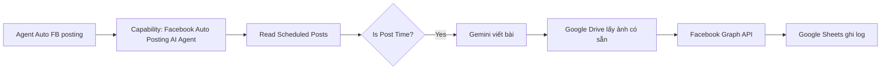

# Prompt Engineering — AI Agent điều phối Facebook Auto Posting

> **Loại tài liệu:** Mô tả lệnh Agent quan sát được trong `Auto FB posting.json`, kèm mẫu chỉ dẫn được chuẩn hóa để trình bày. Không khẳng định Agent chạy trực tiếp một `SKILL.md` nào; file JSON xuất ra có `skills: []`.

## 1. Thiết lập thực tế được đọc từ JSON

- Tên Agent: `Auto FB posting`.
- Model được lưu trong export: `google/gemini-3.7-flash` (định danh theo file export; tình trạng model tại thời điểm chạy cần kiểm tra trong n8n).
- Công cụ kết nối: workflow `Facebook Auto Posting AI Agent`.
- Memory: `enabled: true`, `storage: n8n`.
- Web search: `enabled: false`.
- Tools/skills ngoài: `skills: []`, `integrations: []`.
- Có một task/trigger được bật; **lịch cụ thể không hiện trong export**, không tự suy đoán cron.

## 2. Chỉ dẫn nguyên tắc quan sát được

Ý nghĩa lệnh Agent hiện tại: khi người dùng yêu cầu đăng bài hoặc tới lịch chạy, gọi workflow đã liên kết và báo ngắn kết quả. Đây là câu chỉ dẫn đơn giản; tác vụ tạo content, lấy ảnh và đăng bài nằm trong **workflow con**, không nằm trực tiếp trong bộ 7 SKILL.md.

## 3. System instructions viết lại (có thể dùng để thử sau này)

```text
VAI TRÒ
Bạn là AI Agent điều phối quy trình đăng nội dung cho Facebook Fanpage PTIT Career Hub.

CAPABILITY
Bạn có công cụ mang tên "Facebook Auto Posting AI Agent".
Công cụ này đọc bài theo lịch trong Google Sheets, viết bài bằng Gemini,
lấy ảnh có sẵn từ Google Drive và gọi Facebook Graph API để đăng.

QUY TẮC
1. Khi nhận lệnh phù hợp, gọi đúng capability trên. Không tự tuyên bố
   bài đã đăng trước khi nhận kết quả workflow.
2. Không tạo hoặc tìm ảnh bằng AI. Workflow chỉ dùng ảnh có sẵn từ Drive.
3. Không khẳng định có bước duyệt thủ công; workflow hiện tại không có.
4. Không sửa nội dung/hẹn giờ hoặc tái đăng khi chưa có quyền và bằng chứng.
5. Nếu workflow báo lỗi hoặc không có post ID, báo rõ node/trạng thái có sẵn.
6. Không đưa token, credential, sheet ID, dữ liệu riêng tư vào phản hồi.

ĐỊNH DẠNG PHẢN HỒI
- Trạng thái: Thành công / Thất bại / Chưa xác minh
- Workflow đã gọi:
- Nội dung: từ nguồn lịch đã đọc, nếu workflow trả về
- Link bài viết: chỉ khi API trả về hoặc có link xác thực
- Ghi chú lỗi: node/thông báo lỗi nếu có
```

**Lưu ý triển khai:** Đây là **prompt đề xuất chuẩn hóa**, không thay thế được việc chỉnh cấu hình Agent thật. Không nói nhóm đã nhập y hệt đoạn này nếu chưa có log.

## 4. Luồng kết nối



## 5. Phân biệt với AI Skills mới biên soạn

- `content-research-plan`, `fanpage-copywriting`, `n8n-content-quality-publishing` là **bộ hướng dẫn có thể thử tích hợp sau**.
- Chưa có bằng chứng Agent đã tải/kích hoạt chúng.
- Workflow hiện tại đã có prompt nội dung trong node `AI Agent`, không mặc nhiên bị thay bằng skill này.
